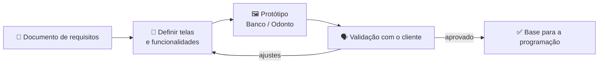

# 🎨 Aula 03 e 04 — Prototipação

Depois da documentação de requisitos, a disciplina avança para a **prototipação**: transformar os requisitos em telas navegáveis que permitem validar o sistema com o cliente antes de programar.

> **Disciplina:** Engenharia de Software II  
> **Tema:** Prototipação de sistemas (banco e odontologia)

---

## 🎯 Objetivos da aula

- 🎨 Transformar requisitos em telas;
- 🧭 Definir fluxo de navegação entre as páginas;
- 🧩 Representar as principais funcionalidades do sistema;
- 🗣️ Validar o protótipo com o cliente e registrar ajustes.

---

## 🗺️ Mapa mental da aula

```text
                      🎨 Prototipação
                            │
        ┌──────────────┬────┴─────────┬──────────────┐
        │              │              │              │
   📄 Requisitos  🖼️ Telas      🧭 Navegação   🗣️ Validação
        │              │              │              │
   Documento      Layout         Fluxo         Feedback
   Escopo         Componentes    Menu          Ajustes
   Regras         Identidade     Rotas         Versão final
```

---

## 🔄 Do requisito ao protótipo



| Etapa | Pergunta que responde |
|---|---|
| **Requisitos** | O que o sistema precisa fazer? |
| **Protótipo** | Como o usuário vai fazer isso? |
| **Validação** | O que precisa mudar antes de programar? |

---

## 📂 Materiais disponíveis

| Arquivo | O que apresenta |
|---|---|
| [📕 atividade03-prototipoBanco.pdf](atividade03-prototipoBanco.pdf) | Protótipo das telas do sistema bancário. |
| [📕 atividade04-prototipoOdonto.pdf](atividade04-prototipoOdonto.pdf) | Protótipo das telas do sistema odontológico. |

---

## 📝 Atividade da aula

Criar o **protótipo navegável** do sistema escolhido, cobrindo as telas principais definidas no documento de requisitos, e apresentar para validação.

---

## 📚 Referências

- GUEDES, G. T. A. *UML 2: Uma Abordagem Prática*. Novatec.
- LARMAN, C. *Utilizando UML e Padrões*. Bookman.
- PAULA FILHO, W. P. *Engenharia de Software: Fundamentos, Métodos e Padrões*. LTC.

---

[← Aula 01 e 02](../Aula%2001%20e%2002%20%E2%80%94%20Levantamento%20de%20Requisitos/README.md) · [📚 Índice da disciplina](../README.md)
